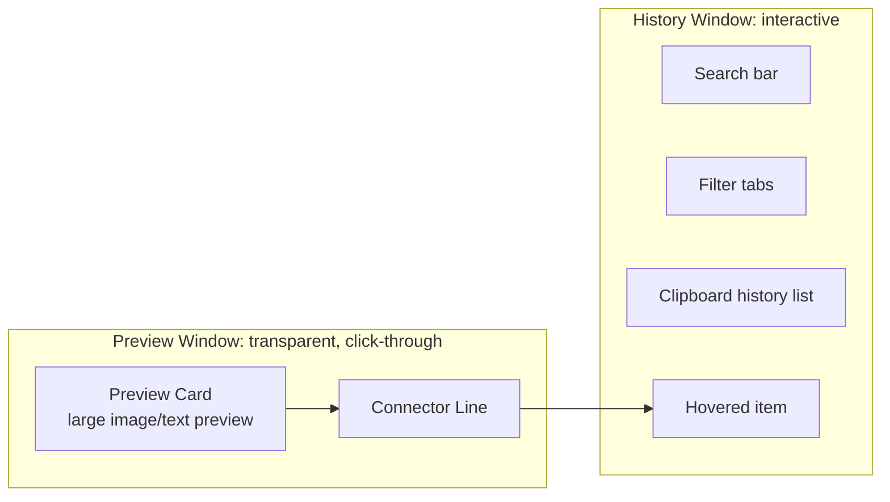
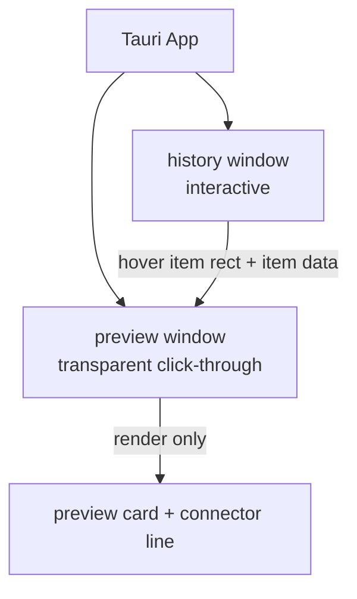
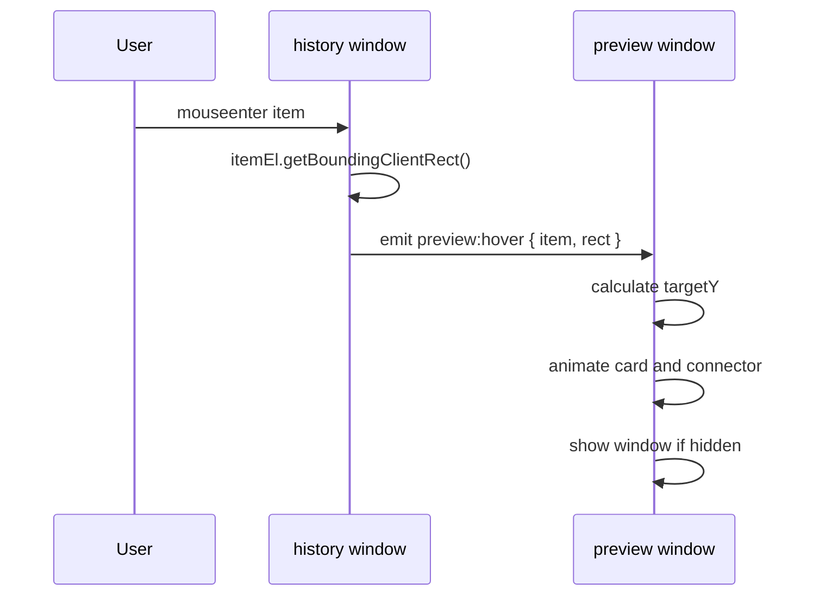
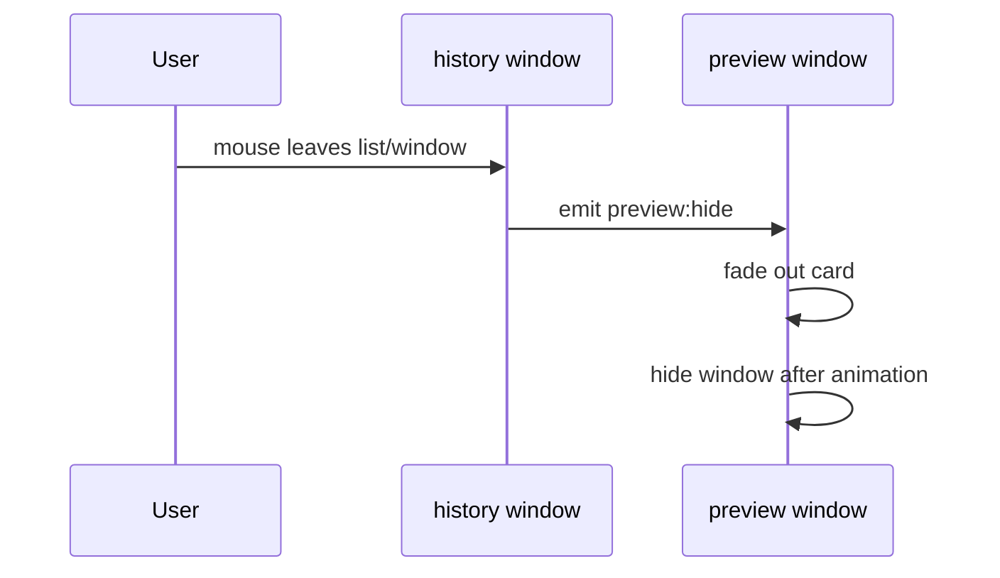
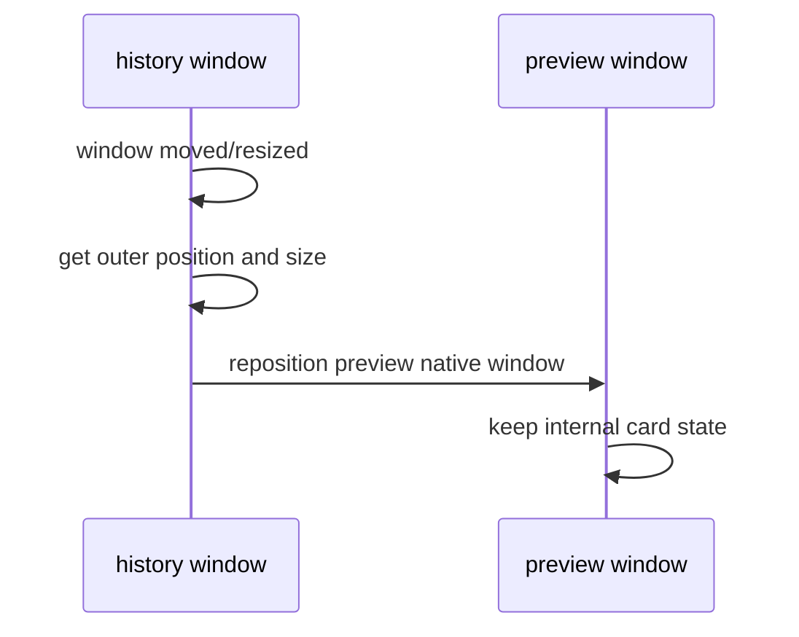
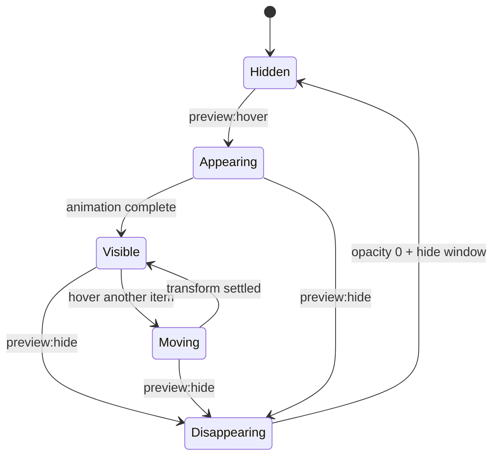
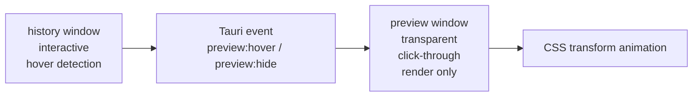

# Tauri Clipboard Hover Preview MVP 实现文档

## 1. MVP 目标

实现一个类似剪切板管理器的 hover preview 效果：

* 右侧是一个剪切板历史窗口，显示 clipboard history list。
* 鼠标 hover 某个历史 item 时，左侧显示一个更大的 preview card。
* preview card 的垂直位置跟随当前 hover item。
* preview card 与右侧 hover item 之间有一条连接线 / connector line。
* preview card 的移动要平滑、优雅，不要像原生窗口在跳动。
* preview window 不应该抢焦点，不应该阻挡鼠标事件。
* 用户实际 hover 的窗口始终是右侧 history window。

最终视觉结构：



## 2. 核心技术方案

MVP 使用 **两个 Tauri window**：

1. `history` window
   右侧主窗口，可交互，接收鼠标 hover、click、scroll、keyboard input。

2. `preview` window
   左侧透明展示层，负责显示 preview card 和 connector line。该窗口设置为：

   * transparent
   * decorations false
   * always on top
   * skip taskbar
   * non-focusable
   * ignore cursor events / click-through

关键设计：

> preview window 不参与鼠标交互，只负责显示。
> hover 检测和坐标计算全部发生在 history window。
> preview card 的移动通过 CSS transform 完成，而不是频繁移动原生窗口。

## 3. 为什么不用全屏透明 overlay

全屏透明 overlay 也能做，但 MVP 不使用该方案。

原因：

* 全屏窗口更容易挡住用户操作。
* 多显示器和 DPI scaling 更复杂。
* click-through 出问题时影响全屏。
* focus、z-index、taskbar、alt-tab 行为更难控制。
* 不需要这么大的透明画布。

MVP 使用较小的 `preview` window，只覆盖 history window 左侧需要显示 preview 的区域。

## 4. 窗口布局

### 4.1 窗口角色



### 4.2 真实窗口矩形

视觉上像这样：

```text
+-------------------------------------------------------------+
|                                                             |
|   preview window                                            |
|   transparent background                                    |
|                                                             |
|   +-------------------------------+                         |
|   | preview card                  |--------- connector ----- | +------------------+
|   | large image / text preview    |                         | | history window   |
|   +-------------------------------+                         | | clipboard list   |
|                                                             | | hovered item     |
+-------------------------------------------------------------+ +------------------+
```

注意：

* `preview window` 是一个透明矩形。
* 用户只看到里面的 preview card 和 connector line。
* connector line 不是第三个窗口，而是 preview window 里的 DOM/SVG 元素。
* preview window 的右边缘应该靠近 history window 的左边缘。

## 5. 推荐窗口尺寸

MVP 可以先使用固定尺寸。

```ts
const HISTORY_WIDTH = 420
const HISTORY_HEIGHT = 680

const PREVIEW_CARD_WIDTH = 640
const PREVIEW_CARD_HEIGHT = 360

const CONNECTOR_WIDTH = 48
const GAP_BETWEEN_CARD_AND_HISTORY = 12
const PREVIEW_PADDING = 16

const PREVIEW_WINDOW_WIDTH =
  PREVIEW_PADDING +
  PREVIEW_CARD_WIDTH +
  CONNECTOR_WIDTH +
  GAP_BETWEEN_CARD_AND_HISTORY

const PREVIEW_WINDOW_HEIGHT = HISTORY_HEIGHT
```

history window：

```text
width: 420
height: 680
```

preview window：

```text
width: 16 + 640 + 48 + 12 = 716
height: 680
```

布局：

```text
preview.x = history.x - preview.width
preview.y = history.y
preview.height = history.height
```

MVP 不需要 preview window 覆盖 history window。connector line 可以画到 preview window 的最右侧，视觉上连接到 history window 左边缘。

## 6. Tauri window 配置

### 6.1 `history` window

```json
{
  "label": "history",
  "url": "index.html#/history",
  "width": 420,
  "height": 680,
  "decorations": false,
  "resizable": false,
  "transparent": true,
  "alwaysOnTop": true,
  "skipTaskbar": true,
  "shadow": true,
  "visible": true,
  "focus": true
}
```

### 6.2 `preview` window

```json
{
  "label": "preview",
  "url": "index.html#/preview",
  "width": 716,
  "height": 680,
  "decorations": false,
  "resizable": false,
  "transparent": true,
  "alwaysOnTop": true,
  "skipTaskbar": true,
  "shadow": false,
  "visible": false,
  "focus": false,
  "focusable": false
}
```

启动后需要对 `preview` window 调用：

```ts
await preview.setIgnoreCursorEvents(true)
await preview.setFocusable(false)
await preview.setAlwaysOnTop(true)
await preview.setSkipTaskbar(true)
```

## 7. Tauri capabilities

Tauri v2 需要给 window API 配 capability。

创建：

```text
src-tauri/capabilities/clipboard-preview.json
```

示例：

```json
{
  "$schema": "../gen/schemas/desktop-schema.json",
  "identifier": "clipboard-preview",
  "description": "Allow clipboard preview windows to be positioned and made click-through.",
  "windows": ["history", "preview"],
  "permissions": [
    "core:window:default",
    "core:window:allow-set-position",
    "core:window:allow-set-size",
    "core:window:allow-show",
    "core:window:allow-hide",
    "core:window:allow-close",
    "core:window:allow-destroy",
    "core:window:allow-set-focus",
    "core:window:allow-set-focusable",
    "core:window:allow-set-always-on-top",
    "core:window:allow-set-skip-taskbar",
    "core:window:allow-set-ignore-cursor-events",
    "core:window:allow-outer-position",
    "core:window:allow-outer-size",
    "core:window:allow-inner-position",
    "core:window:allow-inner-size"
  ]
}
```

## 8. 数据模型

MVP 使用 mock clipboard data，不需要真的接系统剪切板。

```ts
type ClipboardItemType = "text" | "image" | "file"

type ClipboardItem = {
  id: string
  type: ClipboardItemType
  title: string
  subtitle?: string
  createdAt: string
  previewText?: string
  thumbnailUrl?: string
  imageUrl?: string
}
```

Mock 数据：

```ts
const items: ClipboardItem[] = [
  {
    id: "1",
    type: "text",
    title: "TEXT",
    subtitle: "现在不是有无缝吗？能不能这样...",
    createdAt: "00:51",
    previewText: "现在不是有无缝吗？能不能这样，位置线保证和上一个位置一样，不要来回的变换，只有同一个方向的狗，就显示在同一个方向。"
  },
  {
    id: "2",
    type: "image",
    title: "IMAGE",
    subtitle: "Screenshot 1133 x 711",
    createdAt: "06-02 23:48",
    thumbnailUrl: "/mock/screenshot-thumb.png",
    imageUrl: "/mock/screenshot.png"
  }
]
```

## 9. 事件流

### 9.1 Hover item

当鼠标 hover 到 history item：



### 9.2 Mouse leave history list



### 9.3 Window move / resize



## 10. 坐标计算

### 10.1 History window 发送的信息

在每个 item 的 `mouseenter` 或 `mousemove` 中获取 DOMRect：

```ts
const rect = itemEl.getBoundingClientRect()

const payload = {
  item,
  itemRect: {
    top: rect.top,
    left: rect.left,
    width: rect.width,
    height: rect.height
  },
  viewport: {
    width: window.innerWidth,
    height: window.innerHeight
  }
}
```

发送到 preview window：

```ts
import { emitTo } from "@tauri-apps/api/event"

await emitTo("preview", "preview:hover", payload)
```

### 10.2 Preview window 内部计算

preview window 的 `y` 和 history window 的 `y` 对齐，所以 history 内部的 `rect.top` 可以直接映射成 preview window 内部的 Y 坐标。

目标是让 preview card 的垂直中心对齐 hovered item 的垂直中心：

```ts
const hoveredCenterY = itemRect.top + itemRect.height / 2

const rawPreviewY = hoveredCenterY - PREVIEW_CARD_HEIGHT / 2
```

需要 clamp，避免 preview card 超出 preview window：

```ts
function clamp(value: number, min: number, max: number) {
  return Math.min(Math.max(value, min), max)
}

const targetY = clamp(
  rawPreviewY,
  PREVIEW_PADDING,
  viewport.height - PREVIEW_CARD_HEIGHT - PREVIEW_PADDING
)
```

connector line 的 Y 坐标应该对齐 hovered item center，而不是 preview card center：

```ts
const connectorY = hoveredCenterY
```

如果 preview card 被 clamp 到顶部或底部，connector line 应该从 card 右边缘的对应高度伸出来。

可以计算 connector 在 card 内部的 attach Y：

```ts
const attachYWithinCard = clamp(
  hoveredCenterY - targetY,
  24,
  PREVIEW_CARD_HEIGHT - 24
)
```

## 11. Preview window 内部布局

```text
preview window
┌────────────────────────────────────────────────────────────────────┐
│                                                                    │
│  left: 16px                                                        │
│  top: targetY                                                      │
│  ┌──────────────────────────────────────────────┐                  │
│  │ preview card                                 │                  │
│  │                                              │──── connector ───│
│  └──────────────────────────────────────────────┘                  │
│                                                                    │
└────────────────────────────────────────────────────────────────────┘
```

CSS layout：

```css
:root {
  --preview-y: 120px;
  --connector-y: 180px;
  --connector-opacity: 0;
  --card-opacity: 0;
  --card-scale: 0.98;
}

html,
body,
#root {
  margin: 0;
  width: 100%;
  height: 100%;
  background: transparent;
  overflow: hidden;
}

.preview-layer {
  position: relative;
  width: 100vw;
  height: 100vh;
  background: transparent;
  pointer-events: none;
}

.preview-card {
  position: absolute;
  left: 16px;
  top: 0;
  width: 640px;
  min-height: 360px;
  transform:
    translate3d(0, var(--preview-y), 0)
    scale(var(--card-scale));
  opacity: var(--card-opacity);
  transform-origin: right center;
  transition:
    transform 140ms cubic-bezier(0.2, 0.8, 0.2, 1),
    opacity 90ms ease-out;
  border-radius: 12px;
  overflow: hidden;
  background: rgba(255, 255, 255, 0.96);
  box-shadow:
    0 16px 48px rgba(0, 0, 0, 0.28),
    0 0 0 1px rgba(0, 0, 0, 0.08);
}

.connector {
  position: absolute;
  left: 656px;
  top: 0;
  width: 48px;
  height: 1px;
  transform: translate3d(0, var(--connector-y), 0);
  opacity: var(--connector-opacity);
  transition:
    transform 140ms cubic-bezier(0.2, 0.8, 0.2, 1),
    opacity 90ms ease-out;
  background: rgba(120, 150, 220, 0.65);
}

.connector::before {
  content: "";
  position: absolute;
  left: -3px;
  top: -3px;
  width: 7px;
  height: 7px;
  border-radius: 999px;
  background: rgba(120, 150, 220, 0.75);
}

.connector::after {
  content: "";
  position: absolute;
  right: -3px;
  top: -3px;
  width: 7px;
  height: 7px;
  border-radius: 999px;
  background: rgba(120, 150, 220, 0.75);
}
```

## 12. Animation 设计

### 12.1 动画目标

需要实现的感觉：

* hover 到 item 后，preview card 快速淡入。
* card 从轻微缩小状态放大到正常尺寸。
* card 垂直移动跟随 hover item。
* 移动时不要硬跳。
* 切换 item 时，preview 内容可以立即变化，但 card 位置平滑移动。
* connector line 跟着 hovered item 的 centerY 平滑移动。
* 离开列表时，card 和 connector 淡出。

### 12.2 动画状态机



### 12.3 状态变量

Preview UI 需要维护：

```ts
type PreviewState = {
  visible: boolean
  item: ClipboardItem | null
  targetY: number
  connectorY: number
  opacity: number
  scale: number
}
```

### 12.4 Enter animation

当第一次 hover item：

```text
duration: 90ms opacity
duration: 140ms transform
opacity: 0 -> 1
scale: 0.98 -> 1
translateY: previous or targetY -> targetY
easing: cubic-bezier(0.2, 0.8, 0.2, 1)
```

### 12.5 Move animation

当 hover item 改变：

```text
duration: 120ms ~ 160ms
translateY: oldY -> newY
connectorY: oldConnectorY -> newConnectorY
opacity: keep 1
scale: keep 1
easing: cubic-bezier(0.2, 0.8, 0.2, 1)
```

### 12.6 Leave animation

当 mouse leave：

```text
duration: 90ms
opacity: 1 -> 0
scale: 1 -> 0.985
after 120ms: hide native preview window
```

### 12.7 内容切换 animation

MVP 可以简单处理：

* item changed 时直接替换 preview content。
* card 本身不做复杂 crossfade。
* 后续可以加 image fade / content fade。

可选增强：

```text
content opacity: 0.85 -> 1
duration: 80ms
```

## 13. History item hover 行为

每个 item：

```tsx
<div
  className="history-item"
  onMouseEnter={(e) => onItemHover(item, e.currentTarget)}
  onMouseMove={(e) => onItemHover(item, e.currentTarget)}
  onMouseLeave={() => optionalDoNothing()}
>
  ...
</div>
```

建议：

* `mouseenter` 触发 preview。
* `mousemove` 可以低频更新 preview，防止 list scroll 或布局变化导致坐标不准。
* 不要在每个 mousemove 都 emit，使用 `requestAnimationFrame` throttle。

示例：

```ts
let pendingHover: {
  item: ClipboardItem
  el: HTMLElement
} | null = null

let rafId: number | null = null

function scheduleHover(item: ClipboardItem, el: HTMLElement) {
  pendingHover = { item, el }

  if (rafId !== null) return

  rafId = requestAnimationFrame(() => {
    rafId = null
    if (!pendingHover) return

    const { item, el } = pendingHover
    pendingHover = null

    const rect = el.getBoundingClientRect()

    emitTo("preview", "preview:hover", {
      item,
      itemRect: {
        top: rect.top,
        left: rect.left,
        width: rect.width,
        height: rect.height
      },
      viewport: {
        width: window.innerWidth,
        height: window.innerHeight
      }
    })
  })
}
```

## 14. Preview show / hide native window

不要让 preview window 一直显示在桌面上。MVP 做法：

* 第一次 hover 时 show preview window。
* preview UI 内部 opacity 从 0 到 1。
* mouse leave 后 opacity 到 0。
* 动画结束后 hide preview window。

伪代码：

```ts
let hideTimer: number | null = null

listen("preview:hover", async (event) => {
  if (hideTimer) {
    clearTimeout(hideTimer)
    hideTimer = null
  }

  await appWindow.show()

  setState({
    visible: true,
    item: event.payload.item,
    targetY: computeTargetY(event.payload),
    connectorY: computeConnectorY(event.payload)
  })
})

listen("preview:hide", () => {
  setState((s) => ({
    ...s,
    visible: false
  }))

  hideTimer = window.setTimeout(async () => {
    await appWindow.hide()
  }, 140)
})
```

## 15. Window positioning

### 15.1 初始化定位

在 app 启动时：

```ts
const history = getCurrentWindow()
const preview = await WebviewWindow.getByLabel("preview")

const historyPos = await history.outerPosition()
const historySize = await history.outerSize()

await preview.setSize(new PhysicalSize(PREVIEW_WINDOW_WIDTH, historySize.height))
await preview.setPosition(
  new PhysicalPosition(
    historyPos.x - PREVIEW_WINDOW_WIDTH,
    historyPos.y
  )
)
```

### 15.2 history 移动时同步

监听 history window move / resize：

```ts
import { getCurrentWindow, PhysicalPosition, PhysicalSize } from "@tauri-apps/api/window"

const history = getCurrentWindow()
const preview = await WebviewWindow.getByLabel("preview")

async function syncPreviewWindowPosition() {
  const pos = await history.outerPosition()
  const size = await history.outerSize()

  await preview.setSize(new PhysicalSize(PREVIEW_WINDOW_WIDTH, size.height))
  await preview.setPosition(
    new PhysicalPosition(
      pos.x - PREVIEW_WINDOW_WIDTH,
      pos.y
    )
  )
}

await history.onMoved(syncPreviewWindowPosition)
await history.onResized(syncPreviewWindowPosition)
```

MVP 允许轻微延迟。不要每一帧 native reposition，只有 history window move/resize 时同步。

## 16. 文件结构建议

```text
src/
  main.tsx
  routes/
    HistoryWindow.tsx
    PreviewWindow.tsx
  components/
    HistoryList.tsx
    HistoryItem.tsx
    PreviewCard.tsx
    ConnectorLine.tsx
  lib/
    clipboard-mock.ts
    window-layout.ts
    preview-events.ts
    geometry.ts
  styles/
    history.css
    preview.css

src-tauri/
  capabilities/
    clipboard-preview.json
  tauri.conf.json
```

## 17. React component 结构

### 17.1 Router

根据 hash route 渲染不同 window：

```tsx
function App() {
  const hash = window.location.hash

  if (hash.includes("/preview")) {
    return <PreviewWindow />
  }

  return <HistoryWindow />
}
```

### 17.2 HistoryWindow

职责：

* 渲染搜索框、tabs、clipboard list。
* 处理 hover。
* 发送 `preview:hover`。
* mouse leave 时发送 `preview:hide`。
* 初始化和同步 preview native window 位置。

```tsx
export function HistoryWindow() {
  return (
    <div className="history-shell">
      <Header />
      <Tabs />
      <div
        className="history-list"
        onMouseLeave={() => emitTo("preview", "preview:hide")}
      >
        {items.map((item) => (
          <HistoryItem
            key={item.id}
            item={item}
            onHover={scheduleHover}
          />
        ))}
      </div>
    </div>
  )
}
```

### 17.3 PreviewWindow

职责：

* 设置自身 click-through。
* 监听 `preview:hover` 和 `preview:hide`。
* 计算 targetY 和 connectorY。
* 渲染 preview card 和 connector line。

```tsx
export function PreviewWindow() {
  const [state, setState] = useState<PreviewState>({
    visible: false,
    item: null,
    targetY: 120,
    connectorY: 180,
    opacity: 0,
    scale: 0.98
  })

  useEffect(() => {
    const setup = async () => {
      const win = getCurrentWindow()
      await win.setIgnoreCursorEvents(true)
      await win.setFocusable(false)
      await win.setSkipTaskbar(true)
      await win.setAlwaysOnTop(true)
    }

    setup()
  }, [])

  return (
    <div
      className="preview-layer"
      style={{
        "--preview-y": `${state.targetY}px`,
        "--connector-y": `${state.connectorY}px`,
        "--card-opacity": state.visible ? 1 : 0,
        "--connector-opacity": state.visible ? 1 : 0,
        "--card-scale": state.visible ? 1 : 0.985
      } as React.CSSProperties}
    >
      <PreviewCard item={state.item} />
      <ConnectorLine />
    </div>
  )
}
```

## 18. Visual design

### 18.1 History window

```css
.history-shell {
  width: 100vw;
  height: 100vh;
  border-radius: 12px;
  overflow: hidden;
  background: rgba(255, 255, 255, 0.96);
  box-shadow:
    0 16px 48px rgba(0, 0, 0, 0.24),
    0 0 0 1px rgba(0, 0, 0, 0.08);
}

.history-item {
  margin: 8px 12px;
  padding: 12px;
  border-radius: 10px;
  transition:
    background-color 90ms ease-out,
    box-shadow 90ms ease-out,
    transform 90ms ease-out;
}

.history-item:hover {
  background: rgba(80, 130, 255, 0.10);
  box-shadow: 0 0 0 1px rgba(80, 130, 255, 0.35);
}
```

### 18.2 Preview card

Text preview：

```tsx
function PreviewCard({ item }: { item: ClipboardItem | null }) {
  if (!item) return null

  if (item.type === "image") {
    return (
      <div className="preview-card image-preview">
        
        <div className="preview-meta">
          <span>IMAGE</span>
          <span>{item.subtitle}</span>
        </div>
      </div>
    )
  }

  return (
    <div className="preview-card text-preview">
      <div className="preview-meta">
        <span>TEXT</span>
        <span>{item.createdAt}</span>
      </div>
      <pre>{item.previewText}</pre>
    </div>
  )
}
```

CSS：

```css
.text-preview {
  padding: 20px;
}

.text-preview pre {
  margin: 0;
  white-space: pre-wrap;
  font-family:
    ui-monospace,
    SFMono-Regular,
    Menlo,
    Monaco,
    Consolas,
    "Liberation Mono",
    monospace;
  font-size: 13px;
  line-height: 1.6;
  color: #1f2937;
}

.image-preview img {
  display: block;
  width: 100%;
  height: 320px;
  object-fit: cover;
  background: #111827;
}

.preview-meta {
  display: flex;
  justify-content: space-between;
  align-items: center;
  gap: 12px;
  font-size: 12px;
  color: #6b7280;
  padding: 10px 12px;
}
```

## 19. MVP 验收标准

### 19.1 功能验收

* App 启动后显示右侧 history window。
* Hover text item 时，左侧出现 text preview。
* Hover image item 时，左侧出现 image preview。
* Preview card 垂直位置跟随 hovered item。
* Connector line 对齐 hovered item 的 centerY。
* 鼠标移动到 preview window 区域时，不会打断 history hover。
* Preview window 不抢焦点。
* Preview window 不在 taskbar / dock 里显示。
* 离开 history list 后 preview 淡出并隐藏。
* 移动 history window 后 preview window 跟随定位到左侧。

### 19.2 动画验收

* 首次出现：淡入 + 轻微 scale in。
* 切换 item：card 位置平滑移动，不发生 native window 跳动。
* connector line 跟随 hovered item 平滑移动。
* 离开：淡出 + 轻微 scale out。
* 动画不能明显卡顿。
* hover 很快切换多个 item 时，不应该有闪烁。

### 19.3 技术验收

* 不使用全屏 overlay。
* 不使用第三个窗口画 connector。
* 不在 mousemove 中高频调用 `setPosition`。
* preview window 使用 `setIgnoreCursorEvents(true)`。
* history window 负责 hover detection。
* preview window 只负责 render。

## 20. 实现阶段

### Phase 1: 静态双窗口

目标：

* 创建 `history` 和 `preview` 两个 window。
* preview window 透明、无边框、always on top。
* preview window 可以手动 show/hide。
* preview window 能定位在 history 左侧。

完成后应该看到：

```text
[preview transparent area with card] [history list]
```

### Phase 2: click-through

目标：

* preview 调用 `setIgnoreCursorEvents(true)`。
* 鼠标移动到 preview window 覆盖区域，不影响下方窗口。
* preview 不抢 focus。

测试：

* 打开 preview 后，鼠标点击 preview 区域，点击应该穿透到下面窗口或桌面。
* history window hover 不被 preview 影响。

### Phase 3: hover event bridge

目标：

* history item hover 后发送 item data 和 item rect。
* preview 收到事件后渲染对应内容。
* 首次 hover 自动 show preview。

### Phase 4: coordinate + clamp

目标：

* preview card centerY 对齐 hovered item centerY。
* card 不超出 preview window 顶部和底部。
* connector line 对齐 hovered item centerY。

### Phase 5: animation polish

目标：

* 增加 opacity、scale、translateY transition。
* connector line 平滑移动。
* hide 时淡出后 native hide。

## 21. Known limitations

MVP 不解决以下问题：

* preview card 本身可交互。
* 全屏 overlay 模式。
* 多显示器边缘智能翻转。
* history window 在屏幕左边缘时自动把 preview 放右侧。
* Wayland 特殊兼容性。
* 真正系统剪切板读取。
* 图片文件真实缩略图生成。
* rich text / HTML preview。
* 大量 clipboard item virtualization。

这些属于后续版本。

## 22. 后续增强方向

### 22.1 智能方向

如果 history window 左侧空间不够，可以把 preview 放到右侧。

```ts
const shouldPreviewOnLeft = historyX > PREVIEW_WINDOW_WIDTH + 24
const previewX = shouldPreviewOnLeft
  ? historyX - PREVIEW_WINDOW_WIDTH
  : historyX + historyWidth
```

### 22.2 更高级 connector

用 SVG 画曲线：

```svg
<path d="M 0 0 C 20 0, 28 0, 48 0" />
```

或者当 card 被 clamp 时，从 card 边缘对应位置画到 hovered item。

### 22.3 Spring animation

如果 CSS transition 不够自然，可以使用 `framer-motion` 或自写 spring。

推荐 motion 参数：

```ts
{
  type: "spring",
  stiffness: 420,
  damping: 38,
  mass: 0.7
}
```

但 MVP 先用 CSS transition，减少依赖和复杂度。

## 23. 最小实现总结

最终架构必须保持简单：



核心原则：

1. 原生窗口只负责画布位置。
2. 高频动画全部在 WebView 内部用 CSS transform。
3. preview window 永远不抢鼠标。
4. connector line 是 preview window 内部 DOM/SVG，不是第三个窗口。
5. MVP 先做稳定、顺滑、可验证的效果，再考虑高级交互。
